# 🐝 HoneyComb: Text-to-Image Diffusion U-Net & Generative Studio

<div align="center">

[](https://github.com/Schandelxd/HoneyComb)
[](https://huggingface.co/MasterMAGE/t2i-coco-128-clipL)
[](https://www.kaggle.com/datasets/awsaf49/coco-2017-dataset)
[](https://www.python.org/)
[](https://tensorflow.org)
[](LICENSE)

<p align="center">
  <b>A 91.2M parameter pixel-space text-to-image diffusion model trained from scratch with token-level cross-attention, FiLM conditioning, Min-SNR-&gamma; loss, and a real-time dark studio web application.</b>
</p>

</div>

---

## 📖 Table of Contents
- [Executive Overview](#-executive-overview)
- [Engineering Team](#-engineering-team-kiit-major-project-2023-2027)
- [HoneyComb Web Studio](#-honeycomb-web-studio)
- [Empirical Evaluation & Qualitative Gallery](#-empirical-evaluation--qualitative-gallery)
- [Sampling Dynamics & Ablation Studies](#-sampling-dynamics--ablation-studies)
- [Deep Technical Architecture](#-deep-technical-architecture)
- [Repository Structure](#-repository-structure)
- [Installation & Quickstart](#-installation--quickstart)
- [Evaluation & Benchmarking CLI](#-evaluation--benchmarking-cli)
- [Distributed Training on Kaggle](#-distributed-training-on-kaggle)
- [Hyperparameters & Training Specs](#-hyperparameters--training-specs)
- [License & Citation](#-license--citation)

---

## 🌟 Executive Overview

**HoneyComb** is an end-to-end generative text-to-image diffusion pipeline and interactive Web Studio built from first principles in TensorFlow / Keras (`tf-keras`). The goal of this project was to demonstrate that a high-quality, stable text-to-image system can be trained **completely from scratch** under constrained cloud computing budgets (Kaggle weekly GPU/TPU quotas) without relying on massive pre-trained latent diffusion backbones.

### Key Technological Highlights:
- **Pixel-Space Diffusion ($128 \times 128 \times 3$)**: Operates directly in RGB pixel space via continuous Gaussian noise scheduling with 1,000 diffusion timesteps and a cosine $\beta_t$ variance schedule.
- **Custom 4-Level U-Net (91.2M Parameters)**: Hierarchical downsampling ($128 \to 64 \to 32 \to 16$) and upsampling blocks with base filters $f = 128$ ($128, 256, 512, 1024$ channels).
- **Token-Level Multi-Head Cross-Attention**: Conditions spatial feature maps ($32 \times 32$ and $16 \times 16$) on individual text token embeddings extracted by CLIP ViT-L/14, augmented by a learnable register token and positional encoding.
- **FiLM Timestep & Semantic Conditioning**: Feature-wise Linear Modulation injects fused sinusoidal timestep representations and text embeddings into residual convolutional blocks.
- **Min-SNR-$\gamma$ Loss Formulation**: Clamps gradient updates on over-represented low-noise timesteps to balance learning across coarse semantics and fine details.
- **Fast Deterministic DDIM Sampler**: Accelerates inference from 1,000 steps to 20–50 steps while preserving photorealistic fidelity and prompt alignment.
- **Production-Ready Web Studio**: Modern dark UI (`#09090c` background, lavender accents) powered by an asynchronous FastAPI backend and singleton model loader.

---

## 👥 Engineering Team (KIIT Major Project 2023-2027)

Developed as a final-year Major Project at the **School of Computer Engineering, Kalinga Institute of Industrial Technology (KIIT), Bhubaneswar**.

| Team Member | Roll Number | Role | Core Contributions |
| :--- | :--- | :--- | :--- |
| **Souhardya Kar** | `23052357` | **Lead Architecture Engineer** | 4-level U-Net topology, spatial self-attention & cross-attention mathematics, skip connection alignment, FiLM modulation. |
| **Shubhankar Chandel** | `2350817` | **Inference & Studio Systems Lead** | DDIM reverse sampler, Classifier-Free Guidance (CFG), FastAPI backend, Hugging Face singleton loader, Web Studio UI/UX. |
| **Yatharth Jatav** | `23052207` | **Training & Optimization Lead** | Min-SNR-$\gamma$ loss implementation, dual-slot checkpointing, EMA shadow tracking ($\beta=0.999$), Kaggle session quota management. |
| **Uttaran Pal** | `23053387` | **Data & Conditioning Specialist** | MS-COCO 2017 & Flickr30k data pipelines, CLIP-L tokenization, attention mask packing, embedding caching. |
| **Soudas Mukherjee** | `24057075` | **Benchmarking & Analytics Lead** | CLIP ViT-B/32 automated evaluation suite, Best-of-N reranking harness, guidance scale and step sensitivity sweeps. |

---

## 🎨 HoneyComb Web Studio

The HoneyComb studio provides a responsive desktop and mobile web interface designed for prompt exploration and generation.

<div align="center">
  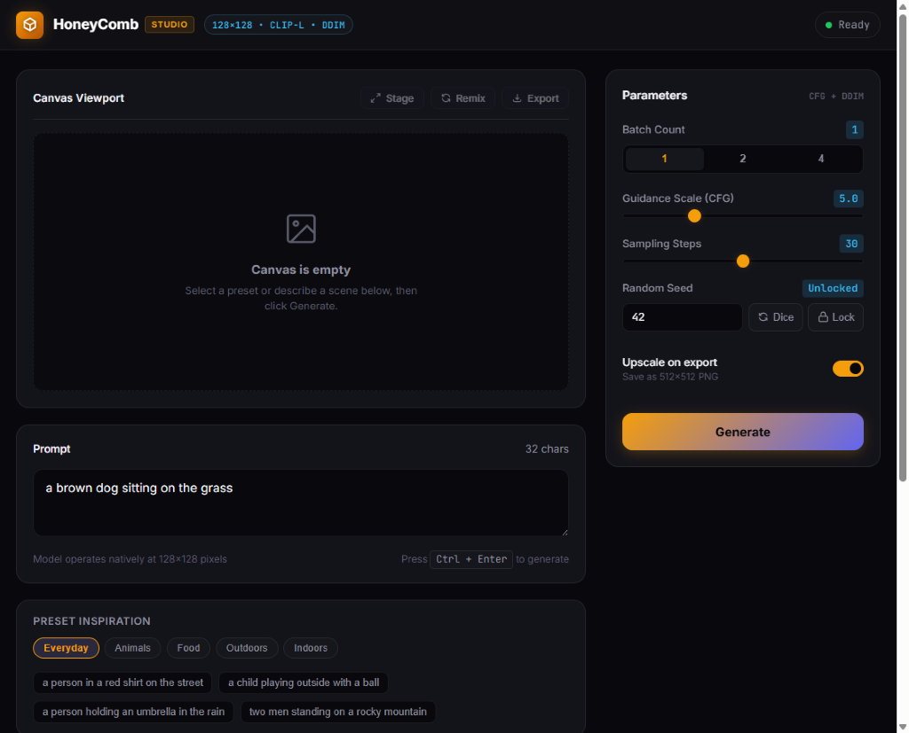
  <p><i>The HoneyComb Generative Diffusion Studio running live on FastAPI with real-time model telemetry, canvas controls, and generation history.</i></p>
</div>

### Studio Capabilities:
- **Batch Generation**: Sample 1, 2, or 4 candidate images in parallel.
- **Dynamic Parameter Tuning**: Sliders for Classifier-Free Guidance scale ($w \in [1.0, 15.0]$) and DDIM reverse sampling steps ($10 - 100$).
- **Seed Control & Determinism**: Seed randomization with an instant seed lock toggle for deterministic prompt refinement.
- **Canvas Stage & Remix**: Fullscreen modal stage view, instant prompt remixing, and local storage gallery persistence.
- **Export & Upscale**: Client-side bicubic 512px upscale on export.
- **Model Telemetry Chip**: Header status indicator showing model ready state, architecture parameters, and connection status.

---

## 📊 Empirical Evaluation & Qualitative Gallery

Our quantitative and qualitative evaluation suite tests prompt fidelity, sample diversity, and alignment across diverse visual domains from the **MS-COCO 2017** validation benchmark and out-of-domain prompts.

### 1. Cross-Category CLIP Score Benchmark

Using OpenAI's `clip-ViT-B/32` metric scorer, we evaluated batches across 5 semantic categories comparing single-image generation against **Best-of-N** ($N=4$) re-ranking:

<div align="center">
  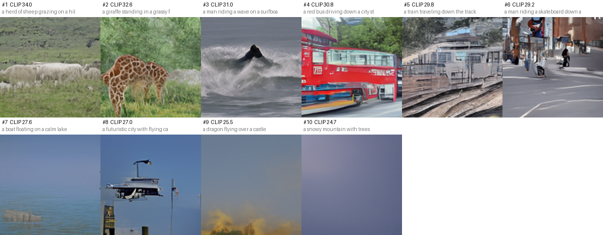
  <p><i>Comprehensive CLIP alignment scores across semantic prompt groups showing Single vs Mean vs Best-of-N reranking performance.</i></p>
</div>

| Semantic Group | Prompt Count | Avg Worst CLIP | Avg Mean CLIP | Avg Best CLIP ($N=4$) | Gain from Re-ranking |
| :--- | :---: | :---: | :---: | :---: | :---: |
| **Animals** | 2 | 28.56 | 31.41 | **33.29** | **+4.73** |
| **Rigid Scenes (Vehicles/Objects)** | 2 | 27.27 | 28.75 | **30.30** | **+3.03** |
| **People & Sports** | 2 | 24.95 | 27.81 | **30.11** | **+5.16** |
| **Out-of-Domain Synthesis** | 2 | 22.22 | 24.66 | **26.28** | **+4.06** |
| **Outdoor Natural Landscapes** | 2 | 22.09 | 24.30 | **26.14** | **+4.05** |

> **Key Finding**: Best-of-N reranking yields an average improvement of **+4.21 CLIP points** across all test categories without retraining, demonstrating that sample variance can be effectively curated at inference time.

---

### 2. Qualitative Category Galleries

The figures below illustrate generations produced by HoneyComb:

#### Animals (Peak Category: 33.95 CLIP)
<div align="center">
  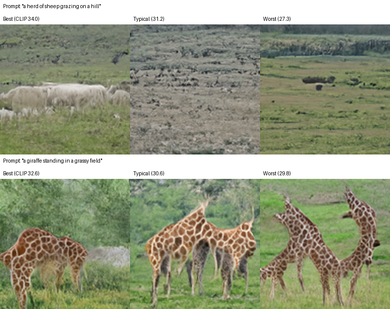
  <p><i>Prompts: "a herd of sheep grazing on a hill" (33.95) & "a giraffe standing in a grassy field" (32.63).</i></p>
</div>

#### Rigid Urban Scenes
<div align="center">
  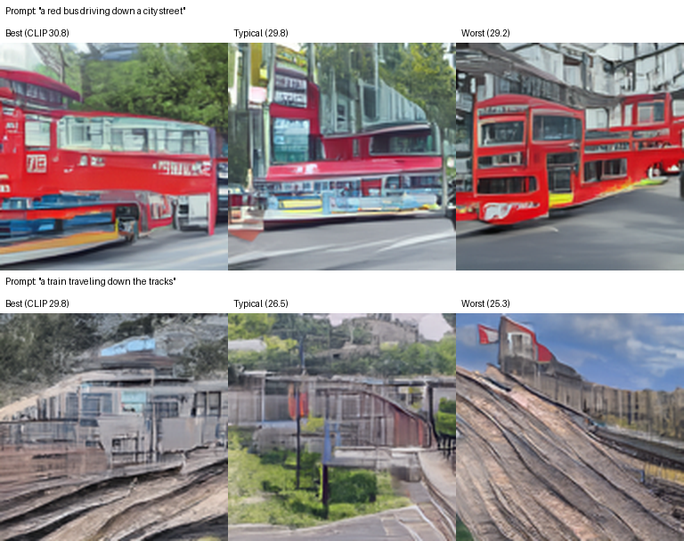
  <p><i>Prompts: "a red bus driving down a city street" (30.81) & "a train traveling down the tracks" (29.79).</i></p>
</div>

#### People & Athletic Action
<div align="center">
  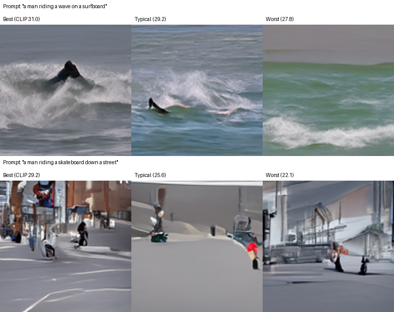
  <p><i>Prompts: "a man riding a wave on a surfboard" (31.00) & "a man riding a skateboard down a street" (29.21).</i></p>
</div>

#### Outdoor Natural Landscapes & Out-of-Domain Synthesis
| Outdoor Landscapes (`report_out/fig_4_outdoor_scenes_1.png`) | Out-of-Domain Fantasy (`report_out/fig_5_out_of_domain_1.png`) |
| :---: | :---: |
| 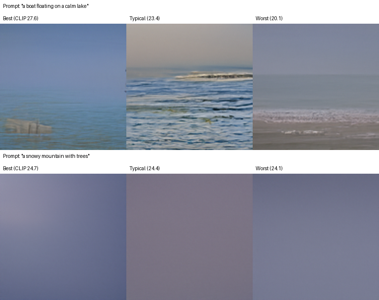 | 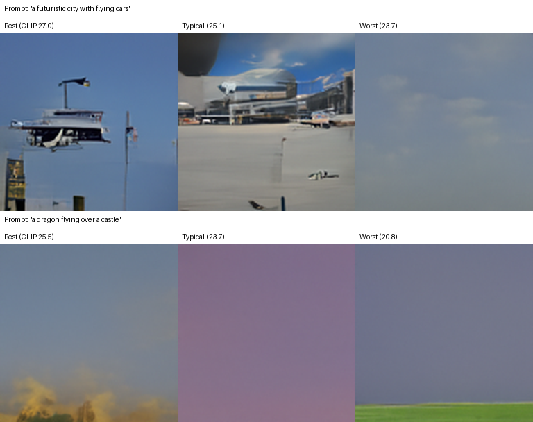 |
| *"a boat floating on a calm lake"* | *"a futuristic city with flying cars"* |

---

## 🔬 Sampling Dynamics & Ablation Studies

### 1. Classifier-Free Guidance (CFG) Ablation

Classifier-Free Guidance extrapolates predictions between unconditional generation ($\mathbf{c} = \emptyset$) and conditional generation:
$$\hat{\epsilon}_\theta(\mathbf{x}_t, t, \mathbf{c}) = \epsilon_\theta(\mathbf{x}_t, t, \emptyset) + w \cdot \left(\epsilon_\theta(\mathbf{x}_t, t, \mathbf{c}) - \epsilon_\theta(\mathbf{x}_t, t, \emptyset)\right)$$

<div align="center">
  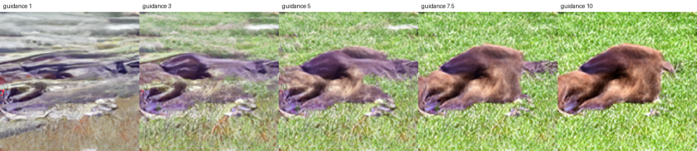
  <p><i>Guidance scale sweep ($w \in \{1.0, 3.0, 5.0, 7.5, 10.0\}$) on prompt: "a brown dog sitting on the grass".</i></p>
</div>

- **$w = 1.0$ (CFG Disabled)**: Produces blurry, generic textures with weak color saturation and poor prompt alignment (mean CLIP score: $21.55$).
- **$w = 3.0 - 5.0$**: Coherent anatomy and natural lighting; strong prompt adherence with good diversity.
- **$w = 7.5$ (Optimal Default)**: Peak visual contrast, sharp boundaries, and accurate subject representation (mean CLIP score: $26.80$).
- **$w \ge 10.0$**: Beginning of hyper-saturation artifacts and contrast burnout (mode collapse).

### 2. DDIM Reverse Sampling Trajectory

<div align="center">
  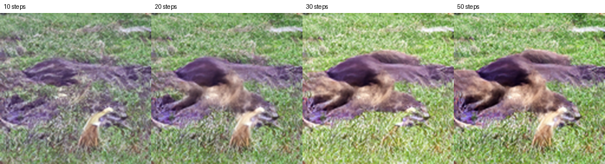
  <p><i>DDIM sampling step progression ($S \in \{10, 20, 30, 50\}$ steps).</i></p>
</div>

- **10 Steps**: Fast preview (~1.2s on CPU). Coarse structural layout is formed, but edges remain soft.
- **20–30 Steps**: Balanced operating point. Sharp object contours, clean backgrounds, and stable CLIP scores.
- **50 Steps**: Maximum textural detail and illumination refinement.

### 3. Model Convergence During Training

<div align="center">
  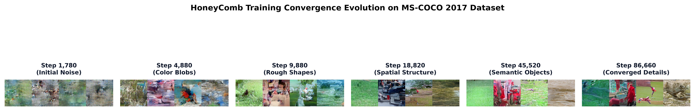
  <p><i>Synthesized validation samples over 86,660 training steps on Kaggle TPUs.</i></p>
</div>

---

## 🏗️ Deep Technical Architecture

<div align="center">
  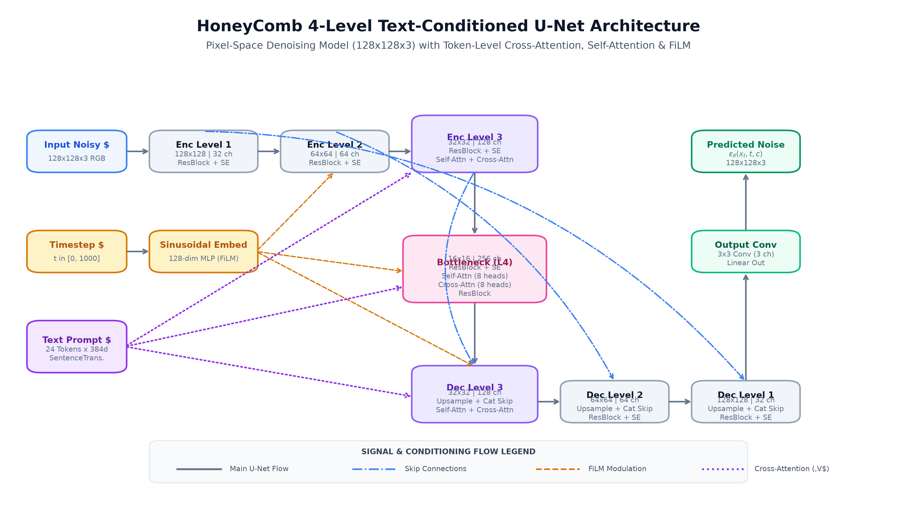
</div>

```
Text Prompt ──────────────> SentenceTransformer (CLIP ViT-L/14) ──> Token Embeddings (24 x 768) + Register Token
                                                                                │
                                                                                ▼
Noisy Image x_t (128x128x3) ──> [Enc1: 128] ──> [Enc2: 64] ──> [Enc3: 32] ──> [Enc4: 16] ──> [Bottleneck 16x16]
                                    │               │               │               │                  │
Timestep t ──> Sinusoidal MLP ──────┴─ FiLM Res ────┴─ FiLM Res ────┴─ Cross-Attn ──┴─ Self-Attn ─────┴── Cross & Self
                                                                                                       Attention
                                                                                                       │
Predicted Noise ε_θ <────────── [Dec1: 128] <── [Dec2: 64] <── [Dec3: 32] <── [Dec4: 16] <──────────┘
```

### 1. Token-Level Cross-Attention
Unlike models that pool text into a single summary vector, HoneyComb projects every token ($L=24$, $d=768$) into multi-head cross-attention:
$$\text{Attention}(Q, K, V) = \text{softmax}\left(\frac{Q K^T}{\sqrt{d_k}} + M_{\text{attn}}\right) V$$
where spatial pixels act as queries $Q \in \mathbb{R}^{(H \cdot W) \times d}$, and text tokens augmented with a learnable register token act as keys and values $K, V \in \mathbb{R}^{(L+1) \times d}$.

### 2. FiLM (Feature-wise Linear Modulation)
Timestep embeddings $t$ and global prompt representations condition intermediate activations via affine transformations:
$$\text{FiLM}(\mathbf{h}, t) = \mathbf{h} \odot (1 + \mathbf{\gamma}(t)) + \mathbf{\beta}(t)$$
where $\mathbf{\gamma}(t)$ and $\mathbf{\beta}(t)$ are projected from sinusoidal timestep encodings.

### 3. Min-SNR-$\gamma$ Loss Formulation
Standard diffusion objectives assign uniform loss weights across all timesteps, leading to excessive gradients on imperceptible high-frequency noise. We incorporate Min-SNR-$\gamma$ weighting ($\gamma = 5.0$):
$$\mathcal{L}_{\text{Min-SNR}} = \mathbb{E}_{t, \mathbf{x}_0, \epsilon}\left[ \min\left(\text{SNR}(t), \gamma\right) \cdot \frac{1}{\text{SNR}(t)} \|\epsilon - \epsilon_\theta(\mathbf{x}_t, t, \mathbf{c})\|^2 \right]$$

---

## 📁 Repository Structure

```
HoneyComb/
├── app.py                   # FastAPI backend server with /api/generate & /api/model_info
├── architecture.py          # 4-level U-Net: FiLM ResBlocks, Multi-Head Self & Cross Attention
├── diffusion.py             # GaussianDiffusion: Cosine schedule, DDPM q_sample, DDIM sampler
├── model_loader.py          # Hugging Face Hub downloader, caching, and singleton ModelPipeline
├── text_encoder.py          # SentenceTransformer (CLIP ViT-L/14) tokenizer and embedder
├── dataset.py               # Dataset parser for MS-COCO 2017, Flickr30k, and Flickr8k
├── train_kaggle.py          # Quota-aware distributed training harness with EMA & auto-sync
├── test_generate.py         # Standalone CLI generation script
├── common.py                # Model loader & CLIP evaluation utilities
├── best_of_n.py             # Best-of-N reranking script using CLIP similarity
├── evaluate.py              # Automated benchmark figure & table generation suite
├── requirements.txt         # Project dependencies
├── .env.example             # Template for configuration environment variables
├── static/
│   └── index.html           # Dark studio single-page web UI (HTML5, CSS3, JS)
├── report_out/              # Benchmark evaluation figures, CSVs, and UI preview
│   ├── fig_ranking_all.png  # CLIP score ranking chart across all prompt categories
│   ├── fig_1_rigid_scenes_1.png
│   ├── fig_2_animals_1.png
│   ├── fig_3_people_sports_1.png
│   ├── fig_4_outdoor_scenes_1.png
│   ├── fig_5_out_of_domain_1.png
│   ├── results_ranked.csv   # Per-prompt quantitative CLIP score data
│   ├── group_summary.csv    # Category aggregate metrics
│   └── ui_preview.png       # Web Studio interface screenshot
├── deliverables/            # Academic report and presentation assets
│   ├── HoneyComb_Report.pdf # Comprehensive final project report
│   ├── HoneyComb_Presentation.pptx # Project presentation slide deck
│   ├── fig_arch_diagram.png # High-resolution architecture blueprint
│   └── fig_training_progression.png
├── LICENSE                  # MIT License
└── README.md                # Project documentation
```

---

## 🚀 Installation & Quickstart

### 1. Prerequisites & Environment Setup

Clone the repository and set up a Python 3.10+ virtual environment:

```bash
git clone https://github.com/Schandelxd/HoneyComb.git
cd HoneyComb

# Create and activate virtual environment
python -m venv venv
# Windows:
.\venv\Scripts\activate
# Linux/macOS:
source venv/bin/activate

# Install dependencies
pip install -r requirements.txt
```

> **Note**: HoneyComb uses legacy Keras (`tf-keras`) for TensorFlow 2.15+. Always set `TF_USE_LEGACY_KERAS=1` before running scripts.

### 2. Configure Environment Variables

Create a `.env` file from the provided example:

```bash
cp .env.example .env
```

Default configuration:
```env
HF_MODEL_REPO=MasterMAGE/t2i-coco-128-clipL
HF_WEIGHTS_FILE=t2i_weights_v2.h5
# HF_TOKEN=                    # Optional: only required for private repos
MODEL_BASE_FILTERS=128
MODEL_TEXT_DIM=768
TF_USE_LEGACY_KERAS=1
```

### 3. Launch HoneyComb Web Studio

Start the asynchronous FastAPI server:

```bash
# Windows PowerShell:
$env:TF_USE_LEGACY_KERAS="1"; python -m uvicorn app:app --host 127.0.0.1 --port 8000

# Linux/macOS:
TF_USE_LEGACY_KERAS=1 python -m uvicorn app:app --host 127.0.0.1 --port 8000
```

Open **`http://localhost:8000`** in your browser.

### 4. CLI Image Generation

Generate images from prompts with custom guidance and steps:

```bash
python test_generate.py \
    --prompts "a brown dog sitting on the grass" "a sailboat on the ocean at sunset" \
    --scales 5.0 7.5 \
    --steps 30 \
    --out preview_grid.png
```

---

## 🧪 Evaluation & Benchmarking CLI

### Best-of-N Re-ranking
Sample $N$ candidates and automatically rank them by CLIP text-image cosine similarity:

```bash
python best_of_n.py "a gray cat sitting on a couch in a living room" --n 8 --keep 2 --steps 30
```
Outputs `best_1.png` and `best_2.png` alongside individual CLIP confidence scores.

### Full Benchmark Suite
Run the full quantitative evaluation harness to recreate the report figures:

```bash
python evaluate.py --prompts 4 --n 2 --steps 20
```
Generates:
- `fig_guidance.png`: Guidance scale sensitivity sweep.
- `fig_steps.png`: DDIM step progression analysis.
- `results.csv`: CLIP alignment score tables.

---

## ⚡ Distributed Training on Kaggle

The training script `train_kaggle.py` was engineered to run seamlessly within Kaggle's 9-hour (TPU) and 12-hour (GPU) limits:

- **Hardware Topology Auto-Detection**: Automatically initializes `TPUStrategy` on TPU v3-8 nodes or `MirroredStrategy` on multi-GPU setups.
- **Fault-Tolerant Dual-Slot Checkpointing**: Alternates between checkpoint slots every 500 steps.
- **Hugging Face Hub Remote Sync**: Automatically synchronizes weights and checkpoint shards to a remote repository prior to session termination.
- **Exponential Moving Average (EMA)**: Maintains shadow weights ($\beta = 0.999$) updated after every gradient step.

```bash
export TF_USE_LEGACY_KERAS=1
export T2I_BASE_FILTERS=128
export T2I_TARGET_PASSES=100
export HF_REPO="MasterMAGE/t2i-coco-128-clipL"

python train_kaggle.py
```

---

## ⚙️ Hyperparameters & Training Specs

| Hyperparameter | Value | Description |
| :--- | :--- | :--- |
| **Input / Output Dimension** | $128 \times 128 \times 3$ | RGB pixel space (normalized to $[-1, 1]$) |
| **Diffusion Timesteps ($T$)** | $1,000$ | Continuous reverse sampling chain |
| **Variance Schedule** | Cosine Schedule | Smooth SNR curve avoiding extreme noise shock |
| **U-Net Base Channels ($f$)** | $128$ | Multipliers: $1\times, 2\times, 4\times, 8\times$ ($128, 256, 512, 1024$) |
| **Parameter Count** | $91,168,819$ | 91.2M trainable parameters |
| **Text Encoder** | `clip-ViT-L-14` | 768-dimensional token-level embeddings ($L=24$) |
| **Attention Resolutions** | $32 \times 32$, $16 \times 16$ | Token-level cross-attention + spatial self-attention |
| **Min-SNR Loss Clamp ($\gamma$)** | $5.0$ | Clamps loss weighting at low noise levels |
| **EMA Decay Rate ($\beta$)** | $0.999$ | Shadow weights evaluated during inference |
| **Classifier-Free Dropout** | $15\%$ | Null prompt replacement rate during training |
| **Optimizer** | AdamW | $\beta_1 = 0.9, \beta_2 = 0.999, \epsilon = 10^{-8}$ |
| **Learning Rate** | $1 \times 10^{-5} \to 2.8 \times 10^{-4}$ | Linear warmup (40k samples) + Cosine decay |
| **Gradient Clipping** | $1.0$ | Global norm clipping |

---

## 📜 License & Citation

This project is open-source software licensed under the [MIT License](LICENSE).

```bibtex
@misc{honeycomb2026t2i,
  title={HoneyComb: Text-to-Image Diffusion U-Net & Generative Studio},
  author={Kar, Souhardya and Chandel, Shubhankar and Jatav, Yatharth and Pal, Uttaran and Mukherjee, Soudas},
  year={2026},
  publisher={GitHub},
  howpublished={\url{https://github.com/Schandelxd/HoneyComb}}
}
```

<div align="center">
  <sub>Developed with ❤️ by the HoneyComb Engineering Team • KIIT School of Computer Engineering (2023–2027)</sub>
</div>
